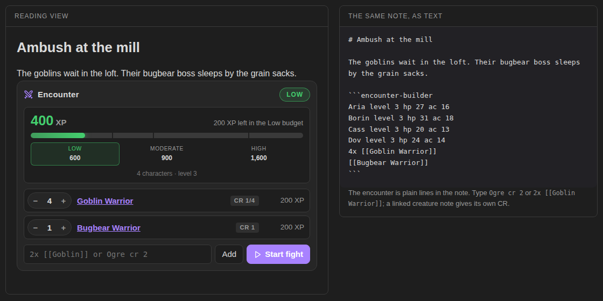

# Encounter Builder

Plan tabletop fights in an Obsidian note. List the party and the monsters, and the block adds up the XP against the 5E encounter budget: low, moderate or high. When it looks right, **Start fight** hands it to [Quick Initiative](https://github.com/walkertbrown/quick-initiative).



**Try it in your browser** before installing: https://bulkhead.bananafest-destiny.com/press/encounter-builder/ runs the real plugin code over a sample note.

## Build an encounter

Write an `encounter-builder` block, one line per character or creature:

````
```encounter-builder
party 4x level 3
3x [[Goblin Warrior]]
[[Bugbear Warrior]]
Ogre cr 2
```
````

Switch to reading view (or live preview) and the block shows:

- the total XP, with a bar marked at the Low, Moderate and High budgets for this party
- each creature with its CR and XP, and **−** / **+** buttons that change the count in the note
- an add box: type `2x [[Wolf]]` or `Troll cr 5` and press Enter
- notes when something looks risky (below)
- **Start fight**, which writes an `initiative` block under the encounter

The command **Insert encounter** drops a starter block at the cursor.

## The party

| Write | Meaning |
| --- | --- |
| `party 4x level 3` | four characters of level 3 |
| `Aria level 4` | one character; any line with a level is a character |
| `Borin player hp 44 ac 18` | a character with no level counts as level 1 |

Mixed levels are fine: each character adds their own budget. Set a **Default party** in settings and you can leave the party out of each encounter.

## Creatures

| Write | Meaning |
| --- | --- |
| `3x [[Goblin Warrior]]` or `x3` | that many, CR read from the linked note |
| `Ogre cr 2` | CR on the line |
| `Bandit captain xp 450` | XP on the line, for creatures from other games |
| `hp 59 ac 11 init +2` | passed on to Quick Initiative |

A linked note gives its CR from a `cr` field in its frontmatter, the way Fantasy Statblocks writes it (`cr: 1/4`, `cr: 0.25` and `cr: 2` all work). Creatures kept only in Fantasy Statblocks' own bestiary (not as notes) are not read; add `cr` to the line.

## The budget

The XP budget per character and the XP for each CR come from the encounter-building rules in the SRD 5.2.1, the 2024 version of the rules:

- **Low**, **Moderate** and **High** are the budget for that difficulty, added up over the party.
- An encounter is the lowest difficulty whose budget its XP fits in. Past High it reads **Over high**.
- There is no multiplier for the number of creatures in these rules. Instead the block warns when a fight has more than two creatures per character, a creature whose CR is above the party's level, more than three different stat blocks, or a crowd of CR 0 creatures.

Turn the warnings off in settings if you know what you're doing.

## Start fight

Press **Start fight** and an `initiative` block appears under the encounter with everyone in it. Characters are marked `player`; levels, CR and XP are left out. With Quick Initiative installed it turns into a tracker, ready to roll. Without it, it's a plain list you can copy anywhere.

## Privacy

Encounter Builder does not use the network, has no accounts, collects nothing and sends nothing. It only edits the `encounter-builder` block it is drawing, and adds the `initiative` block when you press Start fight.

## Install

From Obsidian: Settings → Community plugins → Browse → search "Encounter Builder".

By hand: copy `main.js`, `manifest.json` and `styles.css` from the latest release into `<your vault>/.obsidian/plugins/encounter-builder/`, then enable it under Community plugins.

## Also from this maker

- [Quick Initiative](https://github.com/walkertbrown/quick-initiative): a light initiative tracker that keeps the fight as text in the note.
- [Session Log](https://github.com/walkertbrown/session-log): a quick log for game night. With Quick Initiative, fights log themselves.
- [Dice Tray](https://github.com/walkertbrown/dice-tray): rolls dice, random tables and note sections inline, and reads Dice Roller's `dice:` syntax.
- [Tabletop Clocks](https://github.com/walkertbrown/tabletop-clocks): segmented clocks for danger, plans and factions, ticked with a click and kept as text in the note.

## Source

https://github.com/walkertbrown/encounter-builder

## Build

```
npm install
npm test
npm run build
```

MIT licensed. 5E compatible.

This work includes material from the System Reference Document 5.2.1 ("SRD 5.2.1") by Wizards of the Coast LLC, available at https://www.dndbeyond.com/srd. The SRD 5.2.1 is licensed under the Creative Commons Attribution 4.0 International License, available at https://creativecommons.org/licenses/by/4.0/legalcode.
